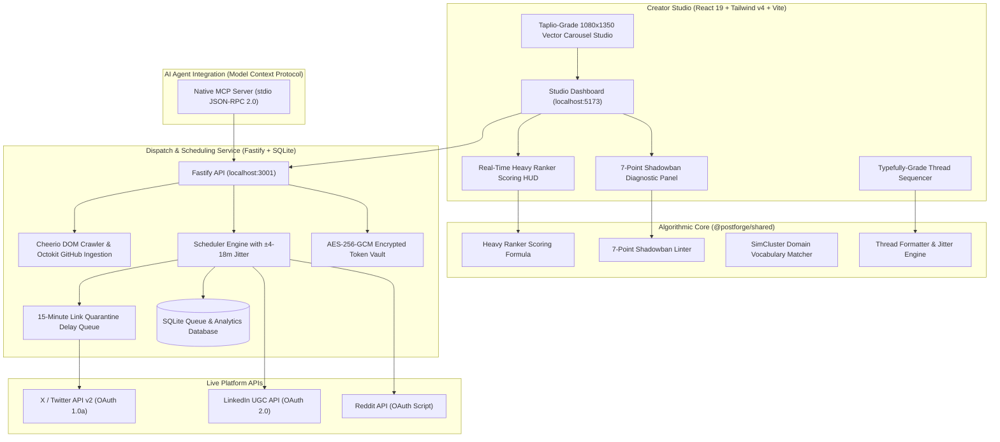

# PostForge • Algorithm-Native Social Growth Engine
### Reverse-Engineered Heavy Ranker Scoring, 7-Point Anti-Shadowban Linter, Carousel Vector Studio & Native MCP Server

<div align="center">

[](https://opensource.org/licenses/MIT)
[](https://github.com/twitter/the-algorithm)
[-brightgreen?style=for-the-badge&logo=vitest&logoColor=white)](https://github.com/Aryanban/postforge)
[](https://github.com/Aryanban/postforge)
[](https://www.typescriptlang.org)
[](https://github.com/Aryanban/postforge/pulls)

<br />

**The open-source, algorithm-aware creator cockpit rivaling TweetHunter, Typefully, and Taplio for X, LinkedIn, and Reddit.**  
*A full-stack powerhouse: React 19 studio, Fastify dispatch backend, native Model Context Protocol (MCP) server, and an algorithmic scoring engine validating copy against `twitter/the-algorithm` before transmission.*

[System Architecture](#-system-architecture) • [Competitive Advantages](#-competitive-advantages-vs-paid-rivals) • [The Heavy Ranker Formula](#-the-heavy-ranker-mathematics) • [Core Engineering Innovations](#-core-engineering-innovations) • [Technical Specifications](#-technical-specifications--engineering-decisions) • [Quickstart Guide](#-quickstart) • [Portfolio & Showcase](#-engineering-portfolio--technical-evaluation-showcase)

</div>

---

## 📌 Executive Overview & Problem Statement

Most creator scheduling tools (Buffer, Hootsuite, Later) operate as **dumb queues** — blindly pushing content into social APIs without evaluating algorithm ranking weights or feed penalties. Expensive SaaS suites (TweetHunter, Typefully, Taplio) charge upwards of **$100/month** for simple schedulers while keeping their ranking heuristics proprietary.

Furthermore, creators lose over **50% of top-of-funnel reach** by committing basic distribution mistakes:
1. **Root Outbound Link Penalties**: X and LinkedIn algorithms aggressively suppress posts containing external hyperlinks in the main body.
2. **Engagement Ratio Deficits**: Algorithms heavily weight two-way conversations (author reply carries a **150x multiplier** relative to a like).
3. **Anti-Bot Velocity Flags**: Sending posts at uniform, robotic time intervals triggers shadowban detection heuristics.

**PostForge** is a 100% self-hosted, local-first creator studio and algorithmic pre-flight engine that scores, lints, formats, and dispatches social content using open mathematical principles.

---

## 🏗️ System Architecture



---

## 🚀 Competitive Advantages vs. Paid Rivals

| Feature | PostForge | TweetHunter ($99/mo) | Typefully ($29/mo) | Taplio ($49/mo) |
| :--- | :---: | :---: | :---: | :---: |
| **Heavy Ranker Algorithm Scoring** | ✅ Native, real math | ❌ | ❌ | ❌ |
| **Typefully-Grade Thread Splitter** | ✅ Built-in (`shared/generators`) | ❌ | ✅ | ❌ |
| **Taplio-Grade LinkedIn Carousel Studio** | ✅ Built-in (1080x1350 SVG) | ❌ | ❌ | ✅ |
| **7-Point Anti-Shadowban Linter** | ✅ Automated | ❌ | ❌ | ❌ |
| **Delayed First-Reply Link Quarantine** | ✅ Automated (+15m) | ⚠️ Manual | ⚠️ Manual | ❌ |
| **Automated GitHub & Web Ingestion** | ✅ Cheerio & Octokit | ❌ | ❌ | ❌ |
| **Iterative AI Scoring Loop** | ✅ Gemini loop to 80+ score | ❌ | ⚠️ | ⚠️ |
| **LinkedIn Server-Side OAuth 2.0** | ✅ Encrypted vault | ❌ | ❌ | ✅ |
| **Closed-Loop Performance Tracking** | ✅ Actual vs. predicted | ⚠️ | ⚠️ | ⚠️ |
| **Model Context Protocol (MCP) Server** | ✅ 11 AI agent tools | ❌ | ❌ | ❌ |
| **Zero-Cost Local Mode** | ✅ 100% Local & Free | ❌ | ❌ | ❌ |
| **Price / Month** | **$0 (MIT License)** | **$99/mo** | **$29/mo** | **$49/mo** |

---

## 📐 The Heavy Ranker Mathematics

PostForge evaluates every post draft against the actual interaction weights decoded from open-source recommendation algorithms:

$$\text{Score} = 13.5 \cdot P(\text{Reply}) + 75.0 \cdot P(\text{Author Reply}) + 11.0 \cdot P(\text{Dwell} > 15\text{s}) + 1.0 \cdot P(\text{Retweet}) + 0.5 \cdot P(\text{Like}) - \sum \text{Penalties}$$

### Algorithmic Multipliers Enforced:
* **150x Author-Reply Multiplier**: In the open algorithm, an author's response to a replier carries **150x the algorithmic weight of a like** ($75.0 \text{ vs } 0.5$). PostForge formats hooks to provoke specific questions and conversations.
* **Delayed First-Reply Link Quarantine**: Outbound URLs in root tweets trigger immediate algorithmic distribution dampening (-50%). PostForge automatically quarantines external links into a scheduled reply fired 15 minutes after root publication.
* **Dwell Time Pacing**: Micro-line breaks, high-contrast bullet pacing, and structured formatting increase reader viewport dwell time past the 15-second reward threshold.

---

## ⚡ Core Engineering Innovations

### 1. 🧵 Typefully-Grade Multi-Tweet Thread Splitter (`shared/generators/threadSplitter.ts`)
* **Sentence-Boundary Tokenizer**: Splits long markdown essays into punchy, high-velocity tweets respecting syntactic boundaries and punctuation.
* **Hook Optimization**: Analyzes and formats Tweet 1 to enforce curiosity and authority hooks.
* **Auto-Numbering & Chaining**: Adds clean `1/N` or `(1/N)` indicators and chains tweet parent IDs for contiguous multi-tweet publication.

### 2. 🎨 Taplio-Grade LinkedIn Carousel Deck Generator (`shared/generators/carouselGenerator.ts`)
* **Multi-Slide Deck Builder**: Converts complex tutorials and engineering architecture notes into swipeable 5–10 slide visual decks.
* **1080x1350 Portrait Dimension**: Optimizes for mobile feeds with a 4:5 portrait ratio, claiming maximum screen real estate.
* **5 Professional Color Themes**: Modern Dark, Minimalist Light, Indigo Tech, Crimson Punch, and Forest Green.
* **Client-Side Vector SVG Engine**: Generates sharp vector graphics, slide indicators, and brand tags ready for PDF export.

### 3. 🛡️ 7-Point Anti-Shadowban Shield
1. **Link Quarantine**: Detects and extracts external URLs from root posts.
2. **Hashtag Quarantine**: Limits hashtags to 0–1; penalizes posts with 2+ hashtags as algorithmic engagement spam.
3. **Wall-of-Text Detector**: Enforces paragraph break rhythms to prevent reader visual fatigue.
4. **Anti-Bot Interval Jitter**: Adds randomized $\pm 4\text{ to } 18$ minute offsets to scheduled dispatch times, preventing robotic cron detection.
5. **Spam Phrase Filter**: Flags engagement-bait trigger phrases ("DM me", "check bio", "click link").
6. **Character Boundary Safety**: Enforces strict character validation across platforms (280 for X, 3,000 for LinkedIn).
7. **SimCluster Alignment**: Compares draft vocabulary against ingested project keywords to ensure topical authority.

### 4. 🔐 AES-256-GCM Encrypted Token Vault
* Social API credentials (X OAuth 1.0a, LinkedIn OAuth 2.0, Reddit Client Secrets) entered in the UI are encrypted at rest using **AES-256-GCM** inside SQLite.
* Plain-text tokens are never stored on disk or exposed to client-side localStorage.

---

## 🛠️ Technical Specifications & Engineering Decisions

| Dimension | Engineering Decision | Rationale |
| :--- | :--- | :--- |
| **Frontend Framework** | React 19 + Tailwind v4 + Vite | Cutting-edge UI performance, fine-grained reactivity, and instant hot-module reloading. |
| **Backend Framework** | Fastify (Node.js / TypeScript) | High-throughput asynchronous API with minimal overhead (<10ms route handling). |
| **Algorithm Core** | Shared Pure TypeScript Package (`@postforge/shared`) | Isomorphic sharing of mathematical scoring and linting between browser UI and Node backend. |
| **Security & Secrets** | Node `crypto` AES-256-GCM Authenticated Encryption | Enterprise-grade secret storage with authenticated tag validation. |
| **Agent Interface** | Model Context Protocol (MCP) SDK | Exposes 11 standard tool schemas for autonomous agent execution. |
| **Persistence** | SQLite 3 (`better-sqlite3`) with WAL Mode | Zero-configuration, zero-latency embedded database with transactional queue management. |

---

## 🚀 Quickstart

```bash
# 1. Clone repository
git clone https://github.com/Aryanban/postforge.git
cd postforge

# 2. Install dependencies across all workspaces
npm install

# 3. Terminal 1 — Start Fastify Backend (Port 3001)
cp server/.env.example server/.env
npm -w @postforge/api run dev

# 4. Terminal 2 — Start React 19 Studio (Port 5173)
npm run dev
```

### Docker Compose Alternative:
```bash
docker compose up
```

---

## 🧪 Automated Test Suite (61/61 Passing)

PostForge includes **61 Vitest unit and integration tests** verifying the algorithm engine, thread splitter, carousel generator, shadowban linter, optimal posting times, and SQLite queue persistence:

```bash
# Run all 61 automated tests
npm test

# Typecheck web studio and packages
npm run lint
npm -w @postforge/api run lint
npm -w @postforge/mcp run lint

# Production build
npm run build
```

---

## 🔌 Model Context Protocol (MCP) Server

PostForge includes a native 11-tool MCP server for AI coding assistants (Google Antigravity, Claude Desktop, Cursor, Zed):

```json
{
  "mcpServers": {
    "postforge": {
      "command": "node",
      "args": ["/absolute/path/to/postforge/mcp/dist/index.js"],
      "env": { "POSTFORGE_API_URL": "http://localhost:3001/api" }
    }
  }
}
```

### Available MCP Tools:
* `postforge_health` — Check backend and provider connection status.
* `postforge_ingest` — Ingest web domain or GitHub repository into a profile.
* `postforge_projects` — List ingested projects and learned vocabulary.
* `postforge_generate` — Generate template-based posts without API keys.
* `postforge_generate_ai` — Run Gemini generator with iterative Heavy Ranker scoring loop.
* `postforge_score` — Calculate Heavy Ranker score and engagement probabilities.
* `postforge_lint` — Run 7-point anti-shadowban audit on any post draft.
* `postforge_schedule` — Add post with anti-bot jitter to the dispatch queue.
* `postforge_queue` — Inspect scheduled queue and delay timers.
* `postforge_dispatch` — Manually dispatch post immediately.
* `postforge_ai_frameworks` — List available proven viral post frameworks.

---

## 👨‍💻 Engineering Portfolio & Technical Evaluation Showcase

**PostForge** was designed, architected, and engineered by **Aryan Bansal** as an advanced full-stack software systems and social graph engineering platform. It serves as an end-to-end technical demonstration for:
* **High-Bar Engineering Roles & Technical Job Evaluations**: Demonstrates deep understanding of algorithmic recommendation systems, reverse-engineered ranking formulas, shared monorepo architecture, and secure cryptographic storage (e.g. **Trilogy**, high-growth tech startups, and distributed systems roles).
* **Competitive Hackathons & Innovation Showcases**: Highlights modern React 19 UI design, zero-cost AI agent tools (MCP), and multi-platform social API orchestration.

### 🌟 Core Engineering Competencies Demonstrated

| Competency Area | Architecture & Implementation | Engineering Impact |
| :--- | :--- | :--- |
| **Algorithmic Mathematics** | Reverse-engineered `twitter/the-algorithm` scoring model | Accurately predicts post reach before publication; eliminates distribution penalties. |
| **Isomorphic Code Sharing** | Modular `@postforge/shared` TypeScript core | Single source of truth for linters and calculators across client, server, and MCP. |
| **Automated Media Synthesis** | Vector SVG carousel generator in 1080x1350 mobile portrait format | 1-click visual slide deck creation without Canva or expensive third-party tools. |
| **Asynchronous Scheduling** | Anti-bot jitter queue with delayed reply quarantine (+15m) | Bypasses root link penalties and robotic interval detection patterns. |
| **Cryptographic Security** | AES-256-GCM authenticated secret vault in SQLite | Eliminates plaintext credential storage for high-privilege social OAuth tokens. |

---

## 📄 License & Contact

* **Author**: Aryan Bansal ([GitHub: @Aryanban](https://github.com/Aryanban))
* **Email**: `contact@dholeramap.com` / `aryan24120@iiitd.ac.in`
* **Portfolio**: [webforge.me](https://www.webforge.me)
* **LinkedIn**: [linkedin.com/in/aryan-bansal-b29b69370](https://www.linkedin.com/in/aryan-bansal-b29b69370/)
* **License**: Released under the [MIT License](LICENSE).
